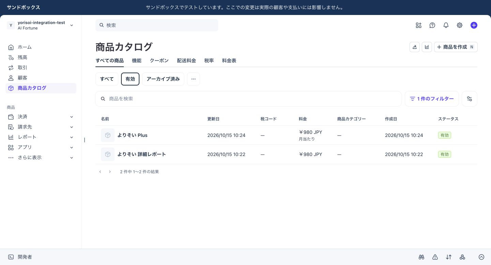
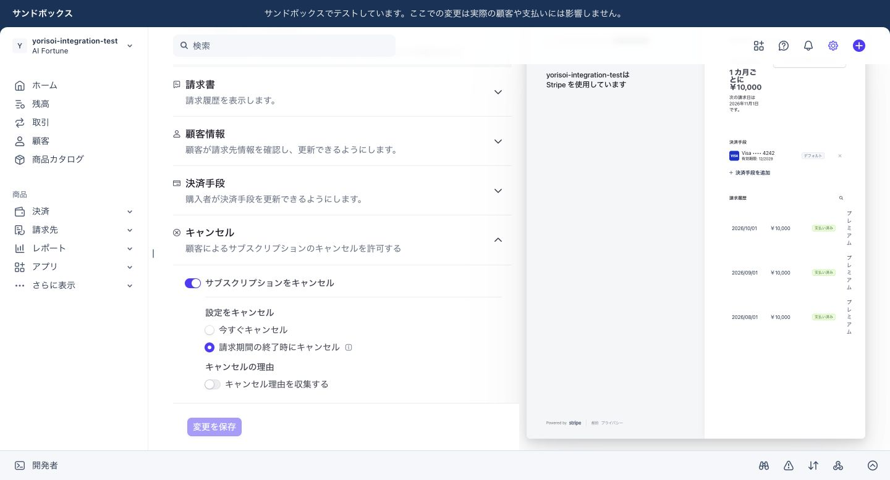

# Phase 6：独立Stripe Sandboxの商品・価格・Portal設定

2026-10-15。対象は `yorisoi-integration-test` / `acct_1UQlQdI73kTcvXz8` のみ。新DB向け初期化SQLは**準備・Docker検証までで、実DBには未適用**。本体アプリの処理と既存17 migrationsは変更していない。

## Stripeで完了した設定

作業前に新SandboxのAccount ID、顧客0、商品0、Webhook送信先0をDashboardで確認。Live側に接続されたStripeプラグインによる書き込みは使用せず、新Sandboxを明示したDashboard / Workbench Shellだけで設定した。商品・価格・PortalのAPI応答はすべて `livemode=false`。

| 項目 | 詳細レポート | Plus |
|---|---|---|
| 商品名 | よりそい 詳細レポート | よりそい Plus |
| Product ID | `prod_VRf89e8A94b0mb` | `prod_VRfAjqXSjem3nl` |
| Price ID | `price_1UQlnvI73kTcvXz8twnU8NIR` | `price_1UQlpjI73kTcvXz814TUAfOd` |
| 金額 / 通貨 | 980 / JPY | 980 / JPY |
| 方式 | one_time、recurring=null | recurring、month、interval_count=1 |
| 自動更新 | なし | 契約作成後は毎月 |
| tax_behavior | inclusive | inclusive |
| Stripe上の状態 | active | active |

各商品に価格は1件。単発価格はDashboard作成後の読取で `unspecified` と判明したため、同じ新価格を `inclusive` に設定し、応答を確認した。価格の重複作成はない。

**税込980円の構成**：JPYのunit_amountは980。両価格で税込を明示し、アプリの単発・月額Checkout実装は `automatic_tax.enabled=false`、数量1。今回Stripe Taxを有効化していない。Tax設定は `status=pending`、本社住所未設定、既定tax_behavior/tax_codeはnull。Productのtax_codeも未設定。商品分類や税申告設定を推測で追加していない。割引・追加商品・送料・税率を追加していないため価格設定上の総額は980円。**Checkout作成・請求額の実測は未実施**。将来の実テストでamount_total=980、currency=jpyを別途照合する。税込価格は税計算・税申告の完了を意味しない。[Stripe税の価格設定](https://docs.stripe.com/tax/products-prices-tax-codes-tax-behavior)

## Customer Portal

Configuration ID：`bpc_1UQlv6I73kTcvXz8G4TVvwUm`。名称 `yorisoi-integration-test`、active=true、is_default=true、livemode=false。

| 機能 | 設定 |
|---|---|
| 請求履歴 | 有効 |
| 支払い方法の更新 | 有効 |
| 解約 | 有効、at_period_end |
| 日割り精算 | none |
| プラン・数量変更 | subscription_update.enabled=false、allowed_updates=[] |
| 一時停止 | 無効 |
| 顧客情報変更 | 無効 |
| 解約理由収集 | 無効 |
| コード不要のログインリンク | 無効 |
| default_return_url | 未設定。隔離Preview確定後、アプリがsession作成時にreturn_urlを指定 |

最初のAPI要求は無効化する解約理由のoptions不足でHTTPエラーになり、作成されなかった。不要な任意指定を外して1件を作成。Dashboardでも同じConfiguration IDと「請求期間の終了時にキャンセル」の選択状態を確認した。変更要求の途中で入力が中断した際も、未送信であることを確認してから入力を完了した。

契約状況と解約予定日はPortalの標準表示を利用する。実顧客・実契約での期限表示、アプリのpaid_through/ended_at反映は未検証。設定画面右側の「プレミアム・10,000円」は**Stripeの固定プレビュー例**であり、作成した980円商品や実契約ではない。[Portal公式説明](https://docs.stripe.com/customer-management)

## 決済能力と追加費用

新Accountの読取結果：`charges_enabled=false`、`payouts_enabled=false`、`details_submitted=false`、capabilities={}、country=JP、default_currency=jpy。事業者登録、本人確認、利用規約の承諾、本番決済有効化を行っていない。

既定Payment Method Configuration `pmc_1UQlRFI73kTcvXz8tcxZmbt4` はactive=true / livemode=false。cardはavailable=true / preference=on。Apple Pay、Link、Bancontact、EPS、Kakao Pay、MB WAY、Naver Pay、Payco、Samsung Payも設定上available/on。JCB、Google Pay、コンビニ、PayPay等はavailable=false/off。**この一覧はJPY980や月額契約で全方式が使える保証ではない**。通貨・端末・継続課金対応によりCheckoutが絞り込む。初回検証はカードに限定する案とし、決済方法設定自体は変更していない。

Sandboxは実銀行・カードネットワークへ資金移動しないテスト環境で、テストカードを利用できる。[公式Sandbox説明](https://docs.stripe.com/sandboxes)、[テストモードの区別](https://docs.stripe.com/testing-use-cases)。ただし、このAccountに対して今回CheckoutもPaymentIntentも作成していないため、**charges_enabled=falseのまま実際にCheckoutを完了できるかは未検証**。次工程で承認された1件のテストCheckoutを試し、権限/能力エラーなら停止する。本番KYCで解決しようとしない。Sandbox設定だけで解決できるか、必要時にStripeサポートへ確認する（連絡も別承認）。

今回の商品・価格・Portal設定による追加費用は0円。新たな有料契約・Stripe Tax・有料オプションを申込んでいない。取引自体も0件。将来のLive料金や他サービスの費用まで無料と保証するものではない。

## APIキーと最小権限

新SandboxのAPIキー一覧で、標準キー（公開可能キー・シークレットキー）の存在とRestricted Keyが0件であることを確認した。値を伏せて状態だけを記録し、キーのコピー・追加発行・Vercel登録は行っていない。Dashboard Shellが新Sandboxに束縛されていることをAccount読取で確認した。アプリ用は新Sandbox専用 `rk_test_` を別途作成する方針。現在のコードの呼出しに基づく候補は次の通り。Stripe Dashboardの実際の権限区分とエラーを照合し、承認なく包括的Writeに広げない。[Restricted API keys](https://docs.stripe.com/keys/restricted-api-keys)

| 対象 | 必要な権限と用途 |
|---|---|
| Account情報 | Read：/v1/account のID照合 |
| Products / Prices | Read：金額、通貨、商品、周期、livemodeの照合。作成・更新権限なし |
| Customers | Read / Write：新テスト顧客の作成・本人との紐付け |
| Checkout Sessions | Read / Write：セッション作成・取得・期限切れ。line_items読取を含む |
| Subscriptions | Read / Write：状態確認、解約・再開等の既存billing API処理 |
| Invoices | Read：支払済み期間の反映 |
| PaymentIntents | Read：Webhookの支払照合 |
| Customer Portal | Configurations Read / Sessions Write。UIで一括区分ならその範囲を発行前に確認 |
| Webhook Endpoints / Products / Prices / Tax設定 | Writeなし。管理設定をアプリキーへ付与しない |
| Refunds / Transfers / Payouts / Balance操作 / Test Clocks | 今回はNone。必要な後続試験ごとに別キー・別承認 |

Webhook署名鍵はAPIキーと別。送信先未作成のため未発行。キーは管理者が暗号化された資格情報保管庫へ直接保管し、チャット・Git・スクリーンショットへ載せない。後日の結合Previewへの登録はPreview限定のSecretとして別承認。既存デモPreviewへは登録しない。漏洩時は新キーだけを失効し、アプリ接続を止める。

## 新DB専用SQL

[初期化SQL](../supabase/environments/ukdzggjfkcwjssjmnqim/stripe-initialize.psql)は自動migrationディレクトリ外のpsqlスクリプト。既存17件に18件目として自動適用しない。対象DB `ukdzggjfkcwjssjmnqim` への**別途適用承認が必要**。

1. 接続HOST/USER/PORT、DB名、session_user/current_user、接続のSSL状態を照合。許可するHosted接続は新refのdirect host、または既に確認済みTokyo session pooler + `postgres.ukdzggjfkcwjssjmnqim`。旧DBのホスト/ユーザーは拒否。
2. DockerのみUnix socket `/tmp` + DB名 `stripe_init_isolated` + postgresを許可。テストランナーがnetwork=noneとポート未公開を確認。通常のHosted DB名postgresはこの経路では通らない。
3. 17 versionの一致、旧Account ID、Sandboxモード、4旧価格が非active、Portal未設定、無料3/Plus30、匿名AI OFFを確認。
4. Auth users/sessionsをロック。アプリのデータテーブルをロックして0件を確認（購入・契約・相談・イベントも含む）。移行で投入された診断カタログ等の静的seedは例外。権限不足は更新前に例外停止。
5. payment_environmentのAccountだけを新Sandboxへ変更。modeはsandboxを維持。
6. 新version `report-integration-202610-980-v1` / `plus-integration-202610-980-v1` をINSERT。実際のProduct/Price ID、980/jpy/is_test=trueを設定し、**両方active=false**。旧4行のID・商品・価格・金額・日時を一切UPDATEしない。
7. Portal IDを設定。既存トリガーを通して検査し、RLS/ACL・旧価格行が不変であることを検証してcommit。すべて1 transaction、lock_timeout=5s、statement_timeout=60s。

価格周期とtax_behaviorはDBのprice_versionsに列がないため、SQLだけでStripeの実値を検証できない。今回のAPI読取証拠と照合し、適用直前にも新SandboxでPrice/Portalを読み取り直す。DBへのAccount ID設定だけでは外部Stripeの所有関係を証明しない。

接続ガードは誤操作対策であり、SQLを自由に改変できる管理者に対する防御ではない。psqlのHOST変数を手動上書きして実行しない。実行前にPGHOSTADDR、PGSERVICE、PGSERVICEFILE、PGOPTIONS等の接続上書きを除去し、`psql -X`、明示host/user/db/port、TLS `verify-full` と検証済みCAを用いる。pooler内部接続でpg_stat_sslの条件が通らない場合も、安全条件を削除せず停止・再設計する。今回クラウド接続でこの経路を検証していない。

## Docker・回帰検証

[検証スクリプト](../scripts/phase6/stripe-init-verify.py)、[結果JSON](phase6-stripe-init-docker-results-20261015.json)。新SQLのSHA256は結果JSONへ記録。既存17件はmanifest SHA256と全件一致。

- 新SQL：29項目成功。通常成功、誤ホスト・各APIロール・Live・旧ID不一致・履歴不足・既存Portal・匿名AI ON・Authユーザー/セッション・匿名診断・Stripeイベント・カタログ不一致・RLS無効・トリガー無効を拒否。
- 中途エラーでAccount/価格/Portalが全てrollback。同時2回では1回だけcommit。再実行拒否、既存ID書換拒否、Live価格有効化拒否。
- 42アプリテーブルのRLS、Auth ACL、policy、関数、トリガー不変。service_roleのauth.users SELECT不可を維持。無料3/Plus30、匿名AI OFF。
- Dockerの初期fixtureでは従来同様のplatform owner権限で17 migrationを作成。**初期化時にAuth SELECTしか持たないケースも別に再現し、ロック不足で停止することを確認**。Hostedのロック権限は未確認で、権限追加で通したとみなさない。
- 初期試行でpsqlの終了コード、接続条件の括弧、API roleのローカル切替方法の問題を検出し修正。失敗をスキップせず、全項目を最初から再実行して成功を確認。
- lint、型チェック、Next.js build：成功。既存Vitest **501件成功**。外部接続 **33件はskip＝未検証**。
- 既存Docker/HTTP16シナリオ：全件成功。Auth権限、引き継ぎ、バックアップ復元、旧1980円/980円・無料/Plusの回帰も成功。GitHub CIはこの変更をpush後に確認する。

CIに今回のオフラインDocker検証を追加した。開発ブランチの `vercel.json` は自動デプロイfalseを維持。アプリコード、既存17 migration、Vercel設定は変更していない。

## 適用前条件・停止・復旧

今回は新旧Supabaseへの接続0、SQL適用0、顧客/契約/決済作成0、Webhook作成0、メール0、AI生成0、Vercel変更0。旧Sandbox/Liveへの書き込み0。既存環境全体の設定差分監査は行っていないが、それらを対象とする変更操作は実行していない。

次回はまず新DBだけで接続確認し、Auth users/sessionsのロックをBEGIN→LOCK→ROLLBACKで事前確認する。権限不足なら停止し、**GRANTを追加せず**修正案を再承認に回す。空状態・RLS・migration17・匿名AI OFF、アプリ未接続・Cron未設定も再確認する。

適用前に新DBだけのスキーマ/ACLとpayment_environment・price_versions・service_settingsを暗号化して新規保存し、ローカル復元を照合する。旧バックアップは上書きしない。SQLのchecksum、接続先、実行開始時刻、結果を秘密値なしで記録する。

SQLエラー時はON_ERROR_STOPで終了し、接続終了により未commit transactionをrollback。新DBの3設定テーブルを読取で比較して実状態を確定する。通信断でcommit結果が不明なら再実行しない。途中反映の有無と新version2件を確認する。commit後の復旧は別承認：アプリを停止したまま全データ0を再確認し、新versionの参照がない場合だけ新2行削除/旧Account・Portal復元を単一transactionで行う復旧案を作る。Auth等の管理スキーマを丸ごと復元しない。データ投入後はAccount再割当てをしない。

必要な次の承認は、(1)新DBのみの読取・ロック検査/暗号化backup/初期化SQL適用、(2)新Sandbox専用Restricted Keyの具体的権限と保管、(3)別Vercel結合PreviewとWebhook準備、(4)新価格2行の有効化と限定テスト取引。これらを自動実行しない。

## 画面証跡

